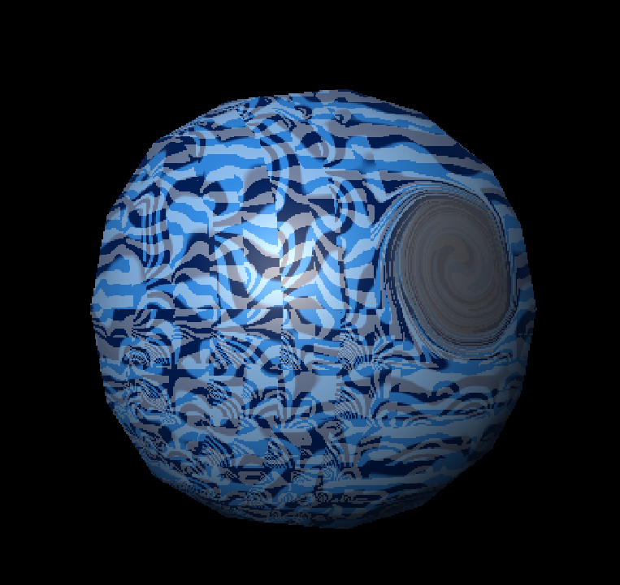
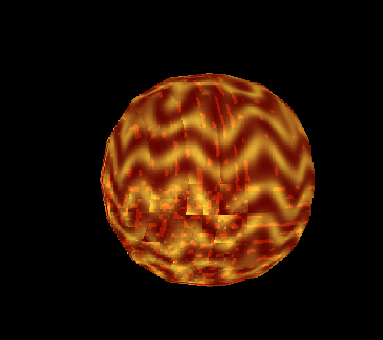

# Viaje por la galaxia con renderer por CPU

Renderer 3D hecho en Rust. La transformación, el ensamblado, la rasterización, la iluminación y los patrones se calculan en CPU; Raylib gestiona la ventana y presenta el framebuffer. Puedes pilotar una nave cargada desde `model/Nave.obj` alrededor de los cuerpos celestes disponibles.

## Repositorio

[github.com/jdivass/shaders](https://github.com/jdivass/shaders)

El repositorio incluye el código Rust, `Cargo.toml` y `Cargo.lock`, y la malla necesaria en `model/sphere.obj`.

## Compilar y ejecutar

Desde la carpeta `shaders`:

```bash
cargo run --release
```

La ventana se centra en el monitor actual y ocupa el 70% de su ancho y el 70% de su alto. El renderer limita su resolución interna a 1280×720 y escala la imagen para ajustarla a la ventana. Si el renderizado tarda más de 17 ms durante 8 cuadros seguidos, reduce la resolución interna; la aumenta gradualmente tras 120 cuadros por debajo de 12 ms. Lejos de los cuerpos puede bajar hasta el 45%; a menos de seis radios de una superficie conserva al menos el 85%, y a menos de dos radios usa la resolución máxima para mantener visibles los detalles.

## Sistema solar y controles

- La estrella está en el origen. Después aparecen el planeta rocoso, el gigante gaseoso, el planeta anillado, el urbano y el boscoso.
- Los planetas recorren órbitas circulares compactas con distintas fases y velocidades, repartidas alrededor del sol.
- Cada órbita se muestra como una línea continua del color principal de su planeta y respeta la profundidad de los cuerpos.
- Cada cuerpo rota sobre su eje y ejerce gravedad dentro de su radio de influencia; la nave colisiona con sus superficies.
- La luz de la estrella central ilumina los cuerpos y la nave desde el origen, con iluminación ambiental para conservar detalle en las sombras.
- El cielo usa `assets/nebulose.jpg` como panorama de una skybox que sigue la orientación de la cámara.
- La resolución adaptativa se aplica a toda la escena.
- `Page Up` / `Page Down`: aumenta o reduce la cobertura de nubes.
- Flechas izquierda/derecha: gira la nave.
- Flechas arriba/abajo: inclina el morro.
- `W` / `S`: acelera hacia delante o hacia atrás.
- `A` / `D`: desplázate lateralmente.
- `R` / `F`: sube o baja.
- `Shift`: aumenta la velocidad máxima.

## Cuerpos celestes

### Planeta rocoso


Usa ruido 3D interpolado y una suma de octavas (`fbm`) para crear variaciones de altura. Un corte suave mezcla océano y tierra; otro umbral añade nieve en las zonas altas. Una luz direccional define día y noche. Las ciudades se forman al combinar una máscara de tierra, regiones de ruido de baja frecuencia y puntos de alta frecuencia; solo se ven en el hemisferio nocturno. El océano tiene reflejos especulares y los continentes una respuesta mate.

Las nubes combinan ruido a escalas `6` y `12` con pesos `0.65` y `0.35`. Su desplazamiento depende del tiempo y no altera el patrón del terreno. La misma máscara, desplazada según la dirección de la luz, produce las sombras sobre la superficie.

Parámetros principales en `src/planet.rs`:

- `fbm(p * 4.0)`: escala del patrón continental. Aumentarla crea formas más pequeñas.
- `smoothstep(0.48, 0.52, height)`: umbral y suavidad de las costas.
- `smoothstep(0.65, 0.78, height)`: umbral de nieve.
- `cloud_coverage`: cobertura ajustada con Page Up y Page Down.
- `0.08` en `shadow_offset` y `0.58` en `direct_light`: desplazamiento e intensidad de las sombras de nubes.

### Gigante gaseoso



Las bandas cubren la esfera siguiendo su latitud y alternan tonos azules. El ruido aporta variación y una tormenta ovalada curva localmente el patrón para formar un vórtice, sin convertir el centro del planeta en una franja uniforme.

Parámetros principales en `shade_gas_giant`, dentro de `src/planet.rs`:

- `geometric_normal.y * 58.0`: cantidad y escala de las bandas principales.
- `turbulence * 1.4`: deformación irregular de las bandas.
- `warped_position.y * 78.0`: frecuencia de las bandas finas.
- Los dos `Vector3` del `mix` principal: colores alternos de las bandas, en componentes RGB normalizados entre `0.0` y `1.0`.
- `storm_center`: ubicación del vórtice; `0.40` y `10.05` en `warp_into_vortex` controlan el radio de influencia y la rotación.
- `storm_color`: color del centro de la tormenta.

### Estrella



La estrella es autoluminosa y no usa el ciclo de día y noche de los planetas. Combina ondas deformadas, celdas sinusoidales y ruido en un valor de calor que mezcla tonos rojos y amarillos. Otra máscara de ruido crea zonas de erupción y un gradiente en el borde da volumen a la esfera. Los patrones se animan con el tiempo.

Parámetros principales en `shade_star`, dentro de `src/planet.rs`:

- `fbm(p * 5.0 + drift)`: escala y movimiento del plasma.
- `p.y * 24.0` y `p.x * 31.0 + p.z * 17.0`: frecuencia de ondas y celdas.
- Los dos `Vector3` del `mix`: colores fríos y calientes de la superficie.
- `noise(p * 16.0 + drift)`: tamaño de las zonas de erupción.

### Planeta anillado

Un Júpiter estilizado con bandas atmosféricas color crema y ocre, una Gran Mancha Roja y anillos generados como una malla de triángulos alrededor del ecuador. Los anillos comparten la profundidad de la escena, por lo que la esfera oculta las partes que pasan detrás.

### Planeta urbano

Inspirado en Trántor, el planeta es una ecumenópolis: una superficie metálica cubierta por distritos, avenidas, torres y ventanas hasta el horizonte. Los detalles urbanos usan tonos materiales y no emiten luz propia.

### Planeta boscoso

Ruido a varias escalas crea regiones de vegetación, claros y lagos en tonos verdes y tierra. Un mapa normal procedural, derivado de ruido de alta frecuencia, perturba la iluminación por fragmento para dar relieve a las copas y a la superficie. El planeta solo recibe la luz direccional, sin brillos añadidos.

## Navegación

La cámara sigue la nave desde atrás. La aceleración conserva la inercia y disminuye gradualmente al soltar `W` o `S`. La nave puede girar, inclinarse, desplazarse lateralmente y cambiar de altura. La gravedad se calcula por separado para cada cuerpo dentro de su radio de influencia y las colisiones mantienen la nave fuera de cada superficie.

## Animación

Los planetas orbitan el sol y también rotan sobre su eje. Los patrones de la estrella, las bandas del gigante gaseoso, el vórtice y las nubes están animados. Todas estas animaciones pueden verse en el siguiente video:


## Cómo funciona el renderer

```text
model/sphere.obj → vértices → transformación y proyección → triángulos → fragmentos → shader → framebuffer
```

`src/object.rs` carga y triangula la malla OBJ. `src/shaders.rs` proyecta los vértices. `src/triangle.rs` y `src/rasterizer.rs` generan fragmentos e interpolan sus atributos. `src/planet.rs` calcula los patrones, colores e iluminación de cada cuerpo celeste. `src/framebuffer.rs` almacena los píxeles y los presenta en la ventana.
