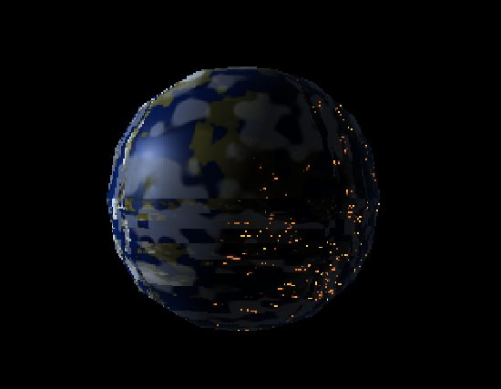
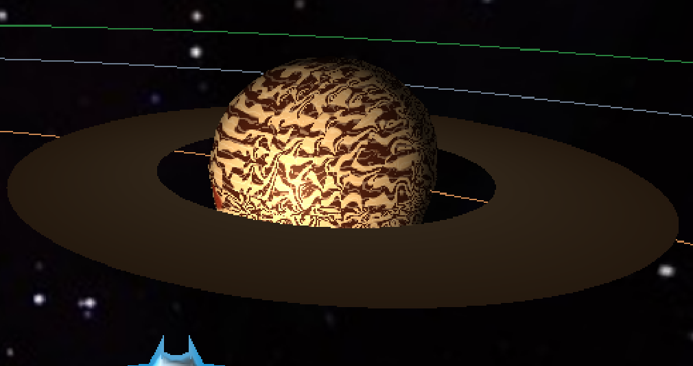
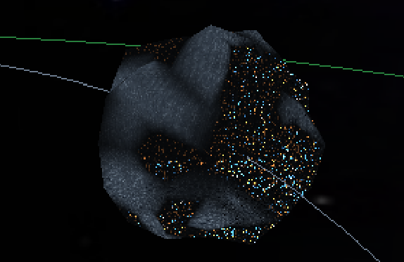
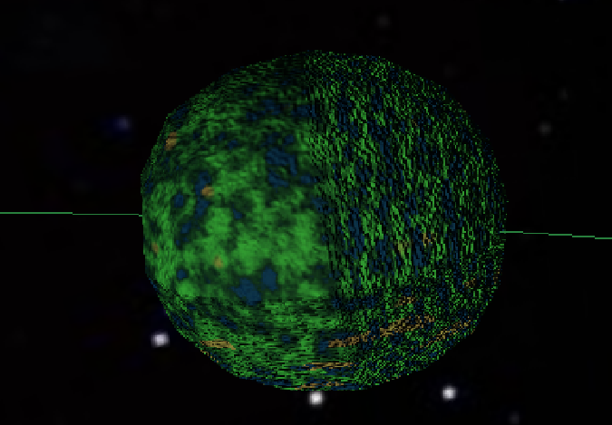

# Viaje por la galaxia con renderer por CPU

Renderer 3D hecho en Rust. La transformación, el ensamblado, la rasterización, la iluminación y los patrones se calculan en CPU; Raylib gestiona la ventana y presenta el framebuffer. Puedes pilotar una nave cargada desde `model/Nave.obj` alrededor de los cuerpos celestes disponibles.

## Repositorio

[github.com/jdivass/solar-system-renderer](https://github.com/jdivass/solar-system-renderer.git)

El repositorio incluye el código Rust, `Cargo.toml` y `Cargo.lock`, los modelos `model/Nave.obj` y `model/sphere.obj`, y los recursos gráficos de `assets/`.

## Compilar y ejecutar

Requisitos: Rust y Cargo instalados, y una sesión gráfica de escritorio.

Desde la raíz de este repositorio:

```bash
cargo run --release
```

La ventana se centra en el monitor actual y ocupa el 70% de su ancho y el 70% de su alto. El renderer limita su resolución interna a 1280×720 y escala la imagen para ajustarla a la ventana. Si el renderizado tarda más de 17 ms durante 8 cuadros seguidos, reduce la resolución interna; la aumenta gradualmente tras 120 cuadros por debajo de 12 ms. Lejos de los cuerpos puede bajar hasta el 45%; a menos de seis radios de una superficie conserva al menos el 85%. Cuando el rendimiento lo permite, también cerca de un planeta usa la resolución máxima para mostrar sus detalles.

## Estructura del proyecto

```text
.
├── assets/             # Skybox y capturas de los cuerpos celestes
├── model/              # Modelos OBJ de la nave y la esfera base
├── src/                # Renderer por software y simulación
│   ├── main.rs         # Escena, cuerpos celestes, controles y bucle principal
│   ├── object.rs       # Carga de modelos OBJ
│   ├── vertex.rs       # Datos de vértice
│   ├── fragment.rs     # Datos de fragmento
│   ├── shaders.rs      # Transformación y proyección de vértices
│   ├── primitive.rs    # Ensamblado de primitivas
│   ├── triangle.rs    # Rasterización de triángulos
│   ├── line.rs         # Rasterización de líneas
│   ├── rasterizer.rs   # Recorrido de triángulos y generación de fragmentos
│   ├── planet.rs       # Shaders de superficie e iluminación
│   ├── transform.rs    # Transformaciones
│   ├── printer.rs      # Impresión de vectores para depuración
│   └── framebuffer.rs  # Almacenamiento y presentación de píxeles
├── Cargo.toml          # Paquete, dependencias y perfiles de compilación
├── Cargo.lock          # Versiones fijadas de dependencias
└── README.md           # Instrucciones, controles y guía de evaluación
```

`main.rs` coordina la simulación y el renderizado. Los módulos de `src/` implementan las etapas del pipeline; los archivos de `model/` y `assets/` contienen los recursos que carga la escena.

## Sistema solar y controles

- La estrella está en el origen. Después aparecen el planeta rocoso, el gigante gaseoso, el planeta anillado, el urbano y el boscoso.
- Los planetas recorren órbitas circulares compactas con distintas fases y velocidades, repartidas alrededor del sol.
- Cada órbita se muestra como una línea continua del color principal de su planeta y respeta la profundidad de los cuerpos.
- Cada cuerpo rota sobre su eje y ejerce gravedad dentro de su radio de influencia; la nave colisiona con sus superficies.
- La luz de la estrella central ilumina los cuerpos y la nave desde el origen, con iluminación ambiental para conservar detalle en las sombras.
- El cielo usa `assets/nebulose.jpg` como panorama de una skybox que sigue la orientación de la cámara.
- La resolución adaptativa se aplica a toda la escena.
- `Page Up` / `Page Down`: aumenta o reduce la cobertura de nubes.
- Flechas izquierda/derecha: gira la nave.
- Flechas arriba/abajo: inclina el morro.
- `W` / `S`: acelera hacia delante o hacia atrás.
- `A` / `D`: desplázate lateralmente.
- `R` / `F`: sube o baja.
- `Shift`: aumenta la velocidad máxima.

## Requisitos obligatorios del proyecto

El PDF condiciona la evaluación al cumplimiento de estos requisitos. La tabla indica el estado actual y cómo comprobar cada uno.

| Requisito | Estado y evidencia |
| --- | --- |
| Render 3D con pipeline propio; Raylib solo para ventana, entrada y presentación | **Implementado.** Transformación, proyección, ensamblado, rasterización, profundidad y shaders de fragmento están en `src/`. Raylib presenta el framebuffer. |
| Sol, nave modelada y controlable, y al menos un planeta con órbita y rotación basadas en tiempo | **Implementado.** Modelos en `model/`; movimiento y controles en `src/main.rs`. |
| Aproximación al planeta y alejamiento sin cambio de escena, manteniendo control y cámara | **Implementado.** La nave y la cámara permanecen en la escena; la resolución adaptativa responde a rendimiento y cercanía. Demostrar el recorrido durante la entrega. |
| Modelos 3D con transformaciones, proyección, prueba de profundidad y al menos un shader de fragmento propio | **Implementado.** Revisar `src/shaders.rs`, `src/triangle.rs`, `src/rasterizer.rs` y `src/planet.rs`. |
| Código, modelos, recursos, instrucciones de ejecución y video corto del recorrido completo | **Parcial.** Código, modelos, recursos e instrucciones están en el repositorio; falta enlazar el video del recorrido completo descrito abajo. |

## Características que se solicitan evaluar

Los puntos siguientes son potenciales: el PDF exige que cada característica funcione durante la demostración y que se pueda explicar. La nota máxima es de 100 puntos.

### Planetas y superficie

| Criterio | Puntos | Estado y evidencia |
| --- | ---: | --- |
| Planeta distinguible que orbita, rota y puede observarse de cerca | 10 por planeta, máximo 50 | **Solicitado para 5 planetas.** Rocoso, gaseoso, anillado, urbano y boscoso; sus aspectos, órbitas y rotación se ven en `src/main.rs` y `src/planet.rs`. El acercamiento y el rendimiento deben mostrarse durante la demostración. |

### Renderizado

| Criterio | Puntos | Estado y evidencia |
| --- | ---: | --- |
| Shader propio con efecto visual distinguible | 6 por shader, máximo 24 | **Implementado.** Efectos distintos para rocoso, gaseoso, anillado/Júpiter, urbano, boscoso y estrella. Hasta cuatro cuentan para el puntaje. `src/planet.rs`. |
| Shader animado | 8 | **Implementado.** Plasma solar, bandas/tormenta del gigante gaseoso y nubes cambian con el tiempo. `src/planet.rs`. |
| Mapeo de normales en el renderer de software | 8 | **Implementado.** El planeta boscoso calcula normales perturbadas por ruido en `forest_surface_normal`, `src/planet.rs`. |
| Deformación de geometría de un planeta mediante ruido u otra función | 10 | **Implementado.** El planeta urbano desplaza vértices antes de proyectarlos y ajusta sus normales; `deform_urban_vertex` en `src/planet.rs`, llamada desde `src/shaders.rs`. |
| Generación o subdivisión procedural de geometría antes de rasterizar | 10 | **Implementado en los anillos.** `create_ring_vertices` genera una malla triangular de 96 segmentos antes de rasterizarla; `src/main.rs`.|

### Navegación

| Criterio | Puntos | Estado y evidencia |
| --- | ---: | --- |
| Aceleración, frenado y giro progresivos, consistentes entre equipos | 8 | **Implementado.** Aceleración e inercia, frenado al soltar acelerador y giro usan el tiempo de cuadro; `src/main.rs`. |
| Gravedad planetaria que modifica la trayectoria | 10 | **Implementado.** Cada cuerpo aplica gravedad con fuerza y radio propios; `src/main.rs`. |
| Colisión que impide atravesar el planeta | 4 | **Implementado.** `resolve_sphere_collision`, `src/main.rs`. |

### Total

| Suma de puntos de criterios anteriores | Total |
| -------------------------------------- | ----- |
| 50 + 24 + 8 + 8 + 10 + 10 + 8 + 10 + 4 | 132 puntos potenciales; nota máxima de 100 |

La resolución adaptativa reduce píxeles y trabajo de fragmentos, pero no cambia la cantidad de triángulos según la distancia. El orden de dibujo por distancia y la omisión de píxeles ya cubiertos por la skybox tampoco descartan objetos completos antes de rasterizar. Por eso no se solicitan los puntos de nivel de detalle ni de descarte de objetos; el PDF pide demostrar ambos mediante una comparación o contadores de triángulos procesados.

## Cuerpos celestes

### Planeta rocoso




Usa ruido 3D interpolado y una suma de octavas (`fbm`) para crear variaciones de altura. Un corte suave mezcla océano y tierra; otro umbral añade nieve en las zonas altas. Una luz direccional define día y noche. Las ciudades se forman al combinar una máscara de tierra, regiones de ruido de baja frecuencia y puntos de alta frecuencia; solo se ven en el hemisferio nocturno. El océano tiene reflejos especulares y los continentes una respuesta mate.

Las nubes combinan ruido a escalas `6` y `12` con pesos `0.65` y `0.35`. Su desplazamiento depende del tiempo y no altera el patrón del terreno. La misma máscara, desplazada según la dirección de la luz, produce las sombras sobre la superficie.

Parámetros principales en `src/planet.rs`:

- `fbm(p * 4.0)`: escala del patrón continental. Aumentarla crea formas más pequeñas.
- `smoothstep(0.48, 0.52, height)`: umbral y suavidad de las costas.
- `smoothstep(0.65, 0.78, height)`: umbral de nieve.
- `cloud_coverage`: cobertura ajustada con Page Up y Page Down.
- `0.08` en `shadow_offset` y `0.58` en `direct_light`: desplazamiento e intensidad de las sombras de nubes.

### Gigante gaseoso


Las bandas cubren la esfera siguiendo su latitud y alternan tonos azules. El ruido aporta variación y una tormenta ovalada curva localmente el patrón para formar un vórtice, sin convertir el centro del planeta en una franja uniforme.

Parámetros principales en `shade_gas_giant`, dentro de `src/planet.rs`:

- `geometric_normal.y * 58.0`: cantidad y escala de las bandas principales.
- `turbulence * 1.4`: deformación irregular de las bandas.
- `warped_position.y * 78.0`: frecuencia de las bandas finas.
- Los dos `Vector3` del `mix` principal: colores alternos de las bandas, en componentes RGB normalizados entre `0.0` y `1.0`.
- `storm_center`: ubicación del vórtice; `0.40` y `10.05` en `warp_into_vortex` controlan el radio de influencia y la rotación.
- `storm_color`: color del centro de la tormenta.

### Sol


El sol es autoluminoso y no usa el ciclo de día y noche de los planetas. Combina ondas deformadas, celdas sinusoidales y ruido en un valor de calor que mezcla tonos rojos y amarillos. Otra máscara de ruido crea zonas de erupción y un gradiente en el borde da volumen a la esfera. Los patrones se animan con el tiempo.

Parámetros principales en `shade_star`, dentro de `src/planet.rs`:

- `fbm(p * 5.0 + drift)`: escala y movimiento del plasma.
- `p.y * 24.0` y `p.x * 31.0 + p.z * 17.0`: frecuencia de ondas y celdas.
- Los dos `Vector3` del `mix`: colores fríos y calientes de la superficie.
- `noise(p * 16.0 + drift)`: tamaño de las zonas de erupción.

### Planeta anillado



Un Júpiter estilizado con bandas atmosféricas color crema y ocre, una Gran Mancha Roja y anillos generados como una malla de triángulos alrededor del ecuador. Los anillos comparten la profundidad de la escena, por lo que la esfera oculta las partes que pasan detrás.

### Planeta urbano



Inspirado en Trántor, el planeta es una ecumenópolis: una superficie metálica cubierta por distritos, avenidas, torres y ventanas hasta el horizonte. Las ventanas y avenidas emiten luz cálida en el hemisferio nocturno, con algunos letreros fríos en las zonas altas. Ruido de baja y alta frecuencia también deforma radialmente la geometría antes de proyectarla; las normales se ajustan a la pendiente para que la iluminación siga el relieve. Conserva su órbita circular alrededor del sol.

### Planeta boscoso



Ruido a varias escalas crea regiones de vegetación, claros y lagos en tonos verdes y tierra. Un mapa normal procedural, derivado de ruido de alta frecuencia, perturba la iluminación por fragmento para dar relieve a las copas y a la superficie. El planeta solo recibe la luz direccional, sin brillos añadidos.

## Navegación

La cámara sigue la nave desde atrás. La aceleración conserva la inercia y disminuye gradualmente al soltar `W` o `S`. La nave puede girar, inclinarse, desplazarse lateralmente y cambiar de altura. Cuando se solapan radios de gravedad, atrae únicamente el cuerpo cuya superficie está más cerca de la nave; las colisiones la mantienen fuera de cada superficie.

## Animación

Los planetas orbitan el sol y también rotan sobre su eje. Los patrones de la estrella, las bandas del gigante gaseoso, el vórtice y las nubes están animados. Todas estas animaciones pueden verse en el siguiente video:


## Entrega y demostración

### Video del recorrido requerido


### Procedencia de modelos y recursos

| Recurso | Uso | Autoría, fuente y licencia |
| --- | --- | --- |
| `model/Nave.obj` | Modelo de la nave | `[Desarrollado en un laboratorio anterior en clase]` |
| `model/sphere.obj` | Malla base de los cuerpos | `[Brindado en un alboratorio anterior]` |
| `assets/nebulose.jpg` | Panorama de la skybox | Fuente externa; pendiente de indicar URL, autor y licencia. |
| `assets/*.png` | Capturas de los cuerpos | Capturas del proyecto. |

Se utilizó asistencia de IA (OpenAI Codex) para implementar y documentar partes del renderer. El código debe poder explicarse durante la demostración.

## Cómo funciona el renderer

```text
model/sphere.obj → vértices → transformación y proyección → triángulos → fragmentos → shader → framebuffer
```

`src/object.rs` carga y triangula la malla OBJ. `src/shaders.rs` proyecta los vértices. `src/triangle.rs` y `src/rasterizer.rs` generan fragmentos e interpolan sus atributos. `src/planet.rs` calcula los patrones, colores e iluminación de cada cuerpo celeste. `src/framebuffer.rs` almacena los píxeles y los presenta en la ventana.

## Autor

Julián Divas - 24687

Contribución técnica concreta para la presentación: pendiente de especificar.
